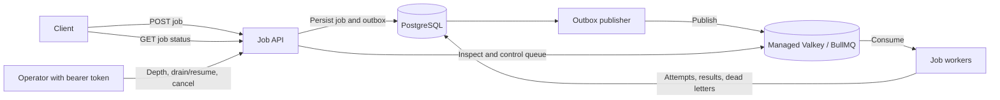

# Digital Ocean Test



A TypeScript REST API and separate DigitalOcean App Platform worker that durably accept jobs in PostgreSQL, publish them to a BullMQ queue through a transactional outbox, execute supported job types, and persist results and exhausted failures. DigitalOcean Functions are not used.

## Requirements

- Node.js 22 or newer
- PostgreSQL 16 or newer
- Redis 7 or Valkey 8

## Configure and run locally

1. Create a PostgreSQL database named `jobs`.
2. Copy `.env.example` to `.env` and set `DATABASE_URL` to your PostgreSQL connection string.
   Set `REDIS_URL` and an `OPERATOR_TOKEN` containing at least 32 random characters for local operation. Generate one with:

   ```powershell
   node -p "require('node:crypto').randomBytes(32).toString('hex')"
   ```
3. Install dependencies and apply the schema:

   ```powershell
   npm ci
   npm run migrate
   ```

4. Start the API:

   ```powershell
   npm run dev
   ```

The API listens on `http://localhost:3000`. `GET /health/live` checks process liveness; `GET /health/ready` checks database connectivity. Job acceptance stays available during a Redis outage while PostgreSQL is available; the publisher retries pending outbox records until Redis recovers. Run the worker locally in a second terminal with `npm run dev:worker`.

## Submit a job

```powershell
Invoke-RestMethod -Method Post -Uri http://localhost:3000/jobs `
  -ContentType 'application/json' `
  -Body '{"payload":{"type":"example","value":42},"priority":0,"maxRetries":3,"timeoutMs":30000}'
```

`payload` must be a JSON object. The initial worker supports the explicit example type `"example"`; its result contains the submitted payload. `priority` defaults to `0` and must be between `-100` and `100`; `maxRetries` defaults to `3` and must be between `0` and `20`; `timeoutMs` defaults to `30000` and must be between `100` and `3600000`. A successful request returns HTTP `201` and a generated job ID with status `accepted`, only after both the job and its outbox intent are committed to PostgreSQL. The publisher later marks it `queued` only after Redis accepts the BullMQ message.

## Check job status

```powershell
Invoke-RestMethod -Method Get -Uri http://localhost:3000/jobs/<job-id>
```

The endpoint returns the job payload, current status, attempt count, last error, result, and lifecycle timestamps. It returns HTTP `404` if no job exists with that UUID and HTTP `400` if the ID is malformed. A new job is `accepted` until queue publication succeeds, then `queued` until a worker claims it. Unsupported payload types fail rather than silently succeeding; after exhausting retries, the job becomes `dead-lettered` and a durable record is written to `job_dead_letters`.

## Visibility and operator controls

All operational routes require `Authorization: Bearer <OPERATOR_TOKEN>`. The token is injected into the API at runtime and must be at least 32 characters; do not expose it to clients or commit it.

```powershell
$headers = @{ Authorization = "Bearer $env:OPERATOR_TOKEN" }
Invoke-RestMethod -Uri http://localhost:3000/ops/queue-depth -Headers $headers
Invoke-RestMethod -Method Post -Uri http://localhost:3000/ops/drain -Headers $headers
Invoke-RestMethod -Method Post -Uri http://localhost:3000/ops/resume -Headers $headers
Invoke-RestMethod -Method Post -Uri http://localhost:3000/ops/jobs/<job-id>/cancel -Headers $headers
```

Queue depth reports accepted and queued work, active executions, delayed jobs, dead letters, the age in seconds of the oldest accepted/queued job, and whether the queue is draining. Drain globally pauses new claims; active attempts are allowed to finish and queue publication can continue. Resume re-enables claims. Pending jobs can be cancelled immediately; cancellation of a running job is cooperative and its handler must honor the provided `AbortSignal`. Terminal jobs cannot be cancelled.

## Migrations, tests, and build

```powershell
npm run migrate
npm test
npm run build
```

Unit tests run without external services. Integration tests start the Fastify API and BullMQ worker, verify atomic PostgreSQL job/outbox persistence, queue consumption and result updates, dead-letter persistence, simulate a Redis outage and recovery, and cover the ambiguous case where Redis accepts a message but its database acknowledgement fails. GitHub Actions starts disposable PostgreSQL 16 and Redis 7 services. To run integration tests locally, set `TEST_DATABASE_URL` and `TEST_REDIS_URL` to disposable services and run:

```powershell
npm run test:integration
```

Never point integration tests at production: the migration creates tables and the test inserts records.

## DigitalOcean deployment

Infrastructure is code-managed in `terraform/`. The GitHub Actions workflows create a private DigitalOcean Spaces bucket for Terraform state, then Terraform provisions managed PostgreSQL and Valkey clusters, database/firewall rules, and the App Platform API service and worker. No DigitalOcean resources are created just by pushing code.

### Estimated monthly cost

The configuration uses single-node PostgreSQL and Valkey plans (`db-s-1vcpu-1gb`, currently listed at **$15/month each**), dedicated-CPU API and worker instances (`apps-d-1vcpu-1gb`, currently **$34/month per instance**), and the Spaces Standard Storage base subscription (**$5/month**, including 250 GiB storage and 1,024 GiB outbound transfer across buckets). With the API and worker at their one-instance minimum, the estimated total is approximately **$103/month** before taxes, additional storage/transfer, or other usage. With both components at their configured maximum of three instances, the estimate is approximately **$239/month**. If a Spaces subscription is already active on the account, the state bucket may use that existing subscription instead of adding another base charge. The single-node databases are not highly available; check current prices and plan details in the DigitalOcean account before applying.

- [Managed PostgreSQL pricing](https://docs.digitalocean.com/products/databases/postgresql/details/pricing/)
- [Managed Valkey pricing](https://docs.digitalocean.com/products/databases/valkey/details/pricing/)
- [App Platform pricing](https://docs.digitalocean.com/products/app-platform/details/pricing/)
- [Spaces pricing](https://docs.digitalocean.com/products/spaces/details/pricing/)

### One-time GitHub and DigitalOcean setup

1. Connect `gauravdelhi1991/digital-ocean-test` to DigitalOcean App Platform in the DigitalOcean control panel. This authorizes App Platform to build the private GitHub repository. Terraform creates a DigitalOcean project named `Digital Ocean Test` and assigns the API, PostgreSQL, and Valkey resources to it.
2. Create a persistent DigitalOcean API token and a Spaces access key in the control panel. Generate a separate random operator token of at least 32 characters with `node -p "require('node:crypto').randomBytes(32).toString('hex')"` and add it as a GitHub Actions repository secret. Add these secrets as `DIGITALOCEAN_TOKEN`, `DO_SPACES_ACCESS_KEY_ID`, `DO_SPACES_SECRET_ACCESS_KEY`, and `OPERATOR_TOKEN`. Do not paste or commit credentials.
3. In GitHub **Settings → Environments**, create `digitalocean-production` restricted to the `main` branch and `digitalocean-candidate` restricted to `feature/*`. These branch restrictions are not approval gates. GitHub Free does not offer required reviewers for private repositories. The workflow therefore requires a separate, manually dispatched apply run with explicit confirmation; this is a deliberate operator action, not an independent reviewer approval.

### Provision

1. Run **Actions → Bootstrap Terraform State Storage → Run workflow**. It creates the private `digital-ocean-test-tfstate-821117` Spaces bucket in `nyc3` if it does not already exist. This starts the Spaces subscription if the account does not already have one.
2. Open a pull request from the feature branch to `main` and wait for CI to pass. Dispatch **Deploy DigitalOcean Infrastructure** from that feature branch with `operation: plan` and set `deployment_branch` to the same feature branch. Review the app source branch and commit alongside the resource changes in the completed run’s summary, and compare the plan with the monthly estimate above and current DigitalOcean prices. Note the plan run ID. The plan expires after one day; apply is rejected if either the infrastructure commit or selected app branch commit changes.
3. Only after reviewing and approving the plan, dispatch the workflow again from the same feature branch with `operation: apply`, enter the plan run ID, and set `confirm_plan: yes`. The workflow uses the `digitalocean-candidate` environment, verifies the exact plan and branch commits, and applies that saved plan; it does not generate and apply a replacement plan. Both database clusters have `prevent_destroy` protection against accidental removal.
4. Verify `https://<app-domain>/health/ready`, submit an `"example"` job, and poll `GET /jobs/{id}` until it reports `succeeded` with the expected result. Submit an unsupported type with `maxRetries: 0` to verify the `dead-lettered` status and corresponding PostgreSQL record.
5. Once the candidate commit passes CI, deploys successfully, and passes the public API/status check, promote that **same commit** to `main` with a fast-forward update. Avoid creating a new merge or squash commit at promotion time, because its SHA would not be the deployed candidate commit. This keeps `main` on the exact tested and deployed revision.

If an App Platform deployment fails, dispatch the workflow from `main` with `operation: inspect` and the app and deployment UUIDs from the failed run. This retrieves that deployment’s status and the API component’s deploy logs; it does not change infrastructure.

The API uses the managed PostgreSQL cluster’s default database account for its first migration and runtime connection. Terraform restricts both managed databases to the App Platform app using database firewall rules. Before handling sensitive production workloads, introduce a least-privilege application database role and a separate migration credential.

The API container and worker entry point apply the idempotent migrations before starting, using a PostgreSQL advisory lock so simultaneous component starts do not race. Terraform state is stored in a private Spaces bucket; deploy runs are serialized by GitHub Actions.

## Configuration

| Variable | Required | Default | Purpose |
| --- | --- | --- | --- |
| `DATABASE_URL` | Yes | — | PostgreSQL connection URI |
| `REDIS_URL` | Yes | — | Redis/Valkey URI (`rediss://` for TLS); the API publishes and the worker consumes queue messages |
| `HOST` | No | `0.0.0.0` | HTTP bind address |
| `PORT` | No | `3000` | HTTP port |
| `LOG_LEVEL` | No | `info` | Structured service log level |
| `WORKER_CONCURRENCY` | Worker only | `5` | Maximum concurrent BullMQ jobs per worker instance |

## Worker configuration and high load

The API publishes to BullMQ on managed Valkey using stable PostgreSQL job IDs. Outbox publication uses capped exponential retry with jitter. The independent App Platform worker uses capped exponential backoff with jitter for execution retries (`maxRetries` counts retries after the first attempt), enforces each job's timeout, persists status and result updates, and transactionally records exhausted failures in `job_dead_letters`. Handlers receive an abort signal and should honor it; handlers with external side effects must be idempotent because queue delivery is at least once. The initial `example` handler returns the payload and demonstrates the handler contract.

The API and worker autoscale independently between one and three dedicated-CPU instances using DigitalOcean App Platform's 70% average CPU target. This requires dedicated-CPU plans and costs more than the original shared-CPU API instance. App Platform uses one CPU target for both scale-up and scale-down; separate 70%/40% thresholds and a configurable five-minute scale-down delay are not supported by its native autoscaler. PostgreSQL connection pools are capped at three connections per process to limit aggregate connections as replicas increase. Continue monitoring queue lag and p95 job latency, and store large job data as object-storage references rather than embedding them in requests.
